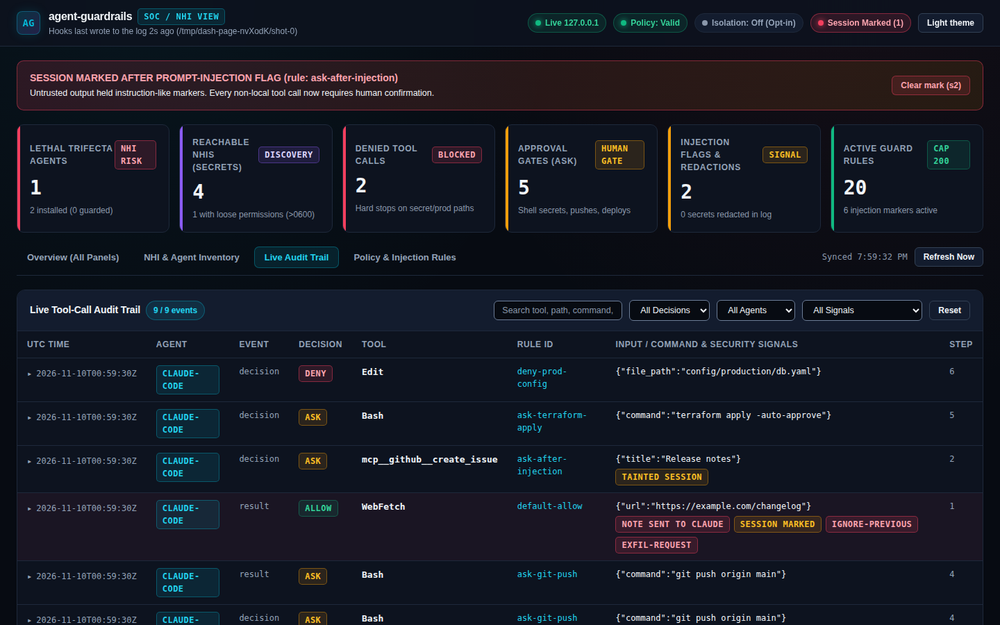

# agent-guardrails [](https://github.com/jdgafx/agent-guardrails/actions/workflows/ci.yml)

A Claude Code plugin that checks each tool call the agent makes before it runs, answers deny, ask or allow from the rules in `policy.json`, and logs what it did. It is for developers and security people who let Claude Code touch files, a shell and MCP tools. It is a rule check on tool calls, not a sandbox. The same rules, log and injection scan also guard Cursor and Codex through their hooks, any stdio MCP server through a proxy, and any CLI agent through a shell wrapper ([other agents](#other-agents)).

It uses only the Python standard library. No API key, no account, no pip install. The hooks open no network connection and no port; the dashboard, when you start it, listens on 127.0.0.1 only and answers only with its key.

## Get started

1. Install it. Run both in a terminal:

```bash
claude plugin marketplace add jdgafx/agent-guardrails
claude plugin install agent-guardrails@agent-guardrails
```

2. Use Claude Code once. The hooks write the log on its first tool call.

3. Start the dashboard. Run this in a terminal (bash or zsh), with nothing else installed:

```bash
(for f in "${CLAUDE_CONFIG_DIR:-$HOME/.claude}"/plugins/cache/agent-guardrails/agent-guardrails/*/dashboard.py; do [ -f "$f" ] && exec python3 "$f"; done; echo "No agent-guardrails dashboard in ${CLAUDE_CONFIG_DIR:-$HOME/.claude}/plugins/cache/agent-guardrails/agent-guardrails/. Install the plugin, or update it to 0.2.0 or later (see Get started)." >&2; exit 1)
```

Open the link it prints. Ctrl-C stops it.

Already on 0.1.0? Update, then restart Claude Code to load the new version:

```bash
claude plugin marketplace update agent-guardrails
claude plugin update agent-guardrails@agent-guardrails
```

No account and no sign-up for the plugin or the dashboard: the dashboard reads the log the plugin writes on your own computer, and neither the plugin nor the dashboard sends anything off it.

## What it does

| Answer | What happens | Example |
|---|---|---|
| **Deny** | A file or MCP tool call whose path field names a secret file or production config does not run. | `Read .env` |
| **Ask** | You are asked first for pushes, recursive deletes, deploys, publishes and MCP tools that send, post, delete or pay. A shell command that names a secret file asks too. | `git push origin main`, `cat .env` |
| **Allow** | A call that no rule matches runs. Claude Code's own permission prompts still apply. | `ls` |
| **Flag** | Tool output with one of six injection phrases is flagged. Claude is told it is data, not instructions, and you see a notice. The text is not removed. | A page that says "ignore previous instructions" |
| **Session mark** | After a flag on WebFetch, WebSearch or MCP read output, every step except local file tools and a few planning tools asks until the session ends. | A shell command after such a page |

A rule that would deny a shell command asks instead, so you can still say yes. After 200 calls in one session, a call that no rule matches asks. Every deny, ask and call that ran is one JSON line in the log (file mode 0600), with seven key formats replaced by `[REDACTED:kind]`. Words used here are in the [glossary](GLOSSARY.md).

## Known limits

- Shell text can be respelled. `cat .e""nv` matches no rule, which is why a shell match asks and does not deny ([limit 4](docs/THREAT_MODEL.md#4-pattern-rules-are-not-a-sandbox)).
- The opt-in isolation layer (off by default: it breaks `ssh` and needs user namespaces) closes respelled shell reads only for the `.env` and credential files its block names, in the project, `~` and `~/.config`. A `*.pem` or `*.key` file outside `~/.ssh` stays ask-only ([what isolation does not stop](docs/ARCHITECTURE.md#what-isolation-does-not-stop), [what it costs](docs/ARCHITECTURE.md#isolation-from-the-users-side)).
- The injection scan is a signal, not a shield. It knows six phrases, so reworded, translated or encoded injections are not flagged ([limit 2](docs/THREAT_MODEL.md#2-the-model-can-still-follow-bad-instructions-inside-allowed-tools)).
- WebFetch hands the hook a summary, not the page, so an injection that the summary drops or rewords is not flagged ([details](docs/THREAT_MODEL.md#2-the-model-can-still-follow-bad-instructions-inside-allowed-tools)).
- Only tool calls are seen. A script the agent writes and runs, or a package you install, is not ([limit 3](docs/THREAT_MODEL.md#3-attacks-outside-claude-code)).
- The agent can still change the guard from the shell. The write tools are denied on its files, but a shell write that names no guard path as an absolute or `~` path is not stopped ([limit 7](docs/THREAT_MODEL.md#7-the-agent-can-change-the-guard-itself)).
- Data can leave the machine (`curl`, WebFetch) in a session that is not marked, unless a rule happens to match ([limit 8](docs/THREAT_MODEL.md#8-little-controls-what-leaves-the-machine)).
- An ask is only as strong as the answer. In `claude -p` nobody can answer, so the call is refused; in interactive bypass mode an ask still showed a prompt in one test ([limits 5 and 6](docs/THREAT_MODEL.md#5-bypass-mode)).
- No spend cap, and the step cap is soft ([limit 1](docs/THREAT_MODEL.md#1-no-spend-cap)).
- A hook that cannot start or times out should block the call on Claude Code 2.1.295 or later (per its release notes; not tested here); older versions probably let it through, and the plugin does not check the version ([limit 9](docs/THREAT_MODEL.md#9-old-claude-code-versions-fail-open)).
- The log is partial, and the agent can edit it from the shell: a declined ask leaves only the decision line, and a secret in an unknown key format is written as is ([log limits](docs/THREAT_MODEL.md#limits-of-the-log)).
- Agents other than Claude Code get less. Codex, the shell wrapper and an MCP client without elicitation cannot ask, so an ask is a refusal. Cursor's own file edits are not checked. The Cursor and Codex adapters follow those agents' hook docs and are tested with payloads in those shapes, not against the live agents ([other agents](docs/ARCHITECTURE.md#other-agents)).
- The inventory guesses what an MCP server can do from its name and command, and does not see connectors that live in an account ([discovery](docs/ARCHITECTURE.md#nhi-and-agent-discovery)).
- CI runs on Linux. macOS and Windows are not tested, and the plugin needs `python3` on PATH ([known gaps](docs/ARCHITECTURE.md#known-gaps)).

Which layer holds which threat, one table: "What holds each threat" in [THREAT_MODEL](docs/THREAT_MODEL.md#what-holds-each-threat).



## Other agents

From a clone (or with `dashboard.py` of an installed plugin in place of `python3 -m guardrails_dashboard`):

```bash
make dashboard ARGS="--scan"             # what is on this computer: agents, MCP servers, reachable secrets
make dashboard ARGS="--install codex"    # or cursor, or claude: wires the hooks, no JSON to copy
```

| Agent | How it is guarded | A call that would ask |
|---|---|---|
| Claude Code | the plugin's hooks | asks you |
| Cursor | `~/.cursor/hooks.json`: shell commands, MCP calls, file reads | asks you (a file read is refused) |
| Codex | `~/.codex/hooks.json`: every tool its hooks see | is refused: a Codex hook cannot ask |
| Any MCP client | `python3 guard.py mcp --name NAME -- <server command>` in place of the server command | asks through MCP elicitation, else is refused |
| Any CLI agent | `python3 guard.py shell` as its `$SHELL` | is refused: nobody can be asked |

`--scan` and the dashboard's **NHI & Agent Inventory** panel list each agent, its MCP servers, the credential files and key names within its reach, and a lethal-trifecta level (CRITICAL when one agent has outside content, secrets and a way to send data out). The scan reads names, paths and permission bits, never a secret value. Details and limits: [ARCHITECTURE](docs/ARCHITECTURE.md#other-agents).

## Try it without Claude Code

From a clone, at its root (needs `make` and `python3` 3.9 or newer, not `uv`):

```bash
make demo
```

It feeds 26 sample tool calls to the real hook scripts and prints the decision for each ([the output](docs/ARCHITECTURE.md#try-it-no-claude-session-needed)). `make dashboard` starts the dashboard from a clone.

## Develop

```bash
make lint     # ruff
make test     # unit, end-to-end and acceptance tests; runs make build first
make build    # re-copy core, the dashboard server and index.html into vendor/
```

`make lint` and `make test` need [uv](https://docs.astral.sh/uv/). `make test` still checks a few doc sentences (`tests/unit/test_t022_doc_agreement.py`, `tests/unit/test_t028_docs_dashboard.py`), so an edit to the README or `docs/` can fail it. Run `make build` after you edit core and commit the result.

## More

[ARCHITECTURE](docs/ARCHITECTURE.md): the controls, install options, the rules file, the session mark, isolation and the audit log format. [THREAT_MODEL](docs/THREAT_MODEL.md): the threats, what holds each one, and every limit in full. [GLOSSARY](GLOSSARY.md): the terms.

License: [MIT](LICENSE).
